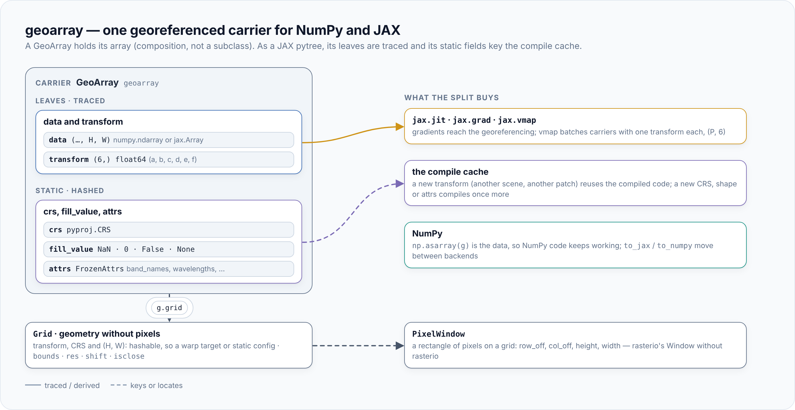

<p align="center">
  <picture>
    <source media="(prefers-color-scheme: dark)" srcset="https://raw.githubusercontent.com/jejjohnson/geotoolz/main/docs/assets/packages/geotoolz-array/logo-dark.svg">
    
  </picture>
</p>

# geotoolz-array

One georeferenced array for the geotoolz stack (import name `geoarray`): a
`GeoArray` holds a NumPy or a JAX array with its affine transform, CRS,
fill value and metadata, and knows which pixel sits where.

A raster is an array plus where its pixels are. georeader's `GeoTensor`
keeps the two together by subclassing `np.ndarray`, which JAX arrays cannot
do: the first `jnp` call drops the georeferencing. `GeoArray` *holds* its
array instead, so the same carrier works on both backends. It is a JAX
pytree whose leaves are the data and a float64 transform, so `jit` reuses
compiled code across scenes and `grad` reaches the georeferencing.

<p align="center"></p>

## Install

```bash
pip install geotoolz-array              # NumPy carriers, Grid, PixelWindow
pip install 'geotoolz-array[jax]'       # + JAX carriers and the pytree
pip install 'geotoolz-array[vector]'    # + footprint as a shapely polygon
```

| Extra | Pulls in | Needed for |
|---|---|---|
| *(base)* | numpy, pyproj, affine | `GeoArray` on NumPy data, `Grid`, `PixelWindow`, `FrozenAttrs` |
| `[jax]` | jax | JAX data, `GeoArray.to_jax`, `jit` / `grad` / `vmap` over carriers |
| `[vector]` | shapely | `footprint` |

A JAX carrier keeps its transform in float64, so it needs
`jax.config.update("jax_enable_x64", True)`; the data keeps its own dtype.

## Quickstart

Wrap a Sentinel-2 chip in UTM 13N, read its grid, then move it to JAX and
jit a function of it.

```python
import jax
import numpy as np

from geoarray import GeoArray, Grid

jax.config.update("jax_enable_x64", True)

# Shapes: C = 2 bands (B11, B12), H × W = 600 × 600 pixels of 20 m
chip: GeoArray = GeoArray(
    np.zeros((2, 600, 600), dtype=np.float32),  # (C, H, W) float32
    (20.0, 0.0, 600000.0, 0.0, -20.0, 3550000.0),  # (a, b, c, d, e, f)
    "EPSG:32613",
    fill_value=np.nan,
    attrs={"band_names": ["B11", "B12"]},
)
grid: Grid = chip.grid  # transform, CRS, (600, 600)
grid.bounds  # (600000.0, 3538000.0, 612000.0, 3550000.0)

on_device: GeoArray = chip.to_jax()  # (C, H, W) float32 · transform float64
total = jax.jit(lambda g: g.data.sum())(on_device)  # () float32
```

Slice it, cut a window by map bounds, and crop patches inside `vmap`:
each result carries the transform of the pixels it holds.

```python
import jax
import jax.numpy as jnp
import numpy as np

from geoarray import GeoArray, PixelWindow, crop, read_window

jax.config.update("jax_enable_x64", True)

# Shapes: C = 2 bands, H × W = 600 × 600 pixels of 20 m
scene: GeoArray = GeoArray(
    np.zeros((2, 600, 600), dtype=np.float32),  # (C, H, W) float32
    (20.0, 0.0, 600000.0, 0.0, -20.0, 3550000.0),  # (a, b, c, d, e, f)
    "EPSG:32613",
    fill_value=np.nan,
).to_jax()

sub: GeoArray = scene[..., 100:356, 200:456]  # (C, 256, 256): the origin moves
window: PixelWindow = scene.grid.window((604000.0, 3542880.0, 609120.0, 3548000.0))
same: GeoArray = read_window(scene, window)  # the same pixels as sub

offsets = jnp.array([[0, 0], [256, 256], [344, 344]])  # (N, 2) int
patches: GeoArray = jax.jit(jax.vmap(lambda o: crop(scene, o, (256, 256))))(offsets)
patches.batch_shape  # (3,): (N, C, 256, 256) data, one (6,) transform per patch
valid = scene.valid_mask()  # (H, W) bool: every band finite and not the fill
```

## What's inside

| Name | Purpose |
|---|---|
| `GeoArray` | The carrier: data, transform, CRS, fill value, attrs; `grid`, `with_data`, `to_jax`, `to_numpy` |
| `Grid` | A pixel grid with no data; hashable, with `bounds`, `res`, `shift`, `crop`, `from_bounds`, `isclose`, `get_config` |
| `PixelWindow` | A rectangle of pixels, rasterio's `Window` without rasterio; `Grid.window` / `Grid.bounds_of` convert to and from map bounds |
| Indexing | `g[...]` and `g.isel(...)`: spatial slices move the transform, band indices select the per-band attrs; `squeeze`, `expand_dims`, `map`, `shift_origin` |
| `crop`, `read_window`, `write_window`, `pad` | Cut, read (padding with fill past the edges), write and pad pixels; `crop` takes traced offsets |
| `GeoArray.valid_mask`, `pixel_coords`, `footprint` | Which pixels hold data; each pixel's map coordinates; the outline as a shapely polygon (`[vector]`) |
| `combine`, `stack`, `concatenate` | Join carriers on one grid (`GridMismatchError` otherwise) |
| `FrozenAttrs` | The immutable, hashable metadata mapping; `PER_BAND_KEYS` |
| `as_transform`, `as_crs` | Coerce an `affine.Affine`, six numbers, an EPSG code or WKT |

The design, its decisions and its roadmap are in
[geoarray: one NumPy/JAX carrier for geotoolz](https://github.com/jejjohnson/geostack/blob/main/docs/design/01_geoarray.md).
